# S&P 500 Stock Data Pipeline and Analysis

> Team 2
> Members: Kenny, Angeline, Suhana, Neo, Michael
## Introduction

This project demonstrates an end-to-end data pipeline and analysis workflow using a one-off static data source on six years of daily price data for S&P 500 stocks with over 600k of records. The data pipeline when through ELT process where it moves from CSV files through Supabase PostgreSQL and further extract and load into Google BigQuery as the destination datawarehouse, where it is further transformed with dbt in Google BigQuery and finally analyzed in Python. From the anlysis we notice some observation and able to extract some business insights on S&P500 stock performance.


## Executive Summary

* Established ELT data pipeline flow from S&P500 csv file data to Supabase(PostgreSQL) and finally to Google BigQuery as the datawarehouse destination.
* Below are a few business insights we obtain from the S&P500 data:
   * AAPL (Apple Inc.) has no incremental annual return growth since the period of 2023-10 to 2024-09.
   * Information Technology produced the strongest average daily return but also the greatest variability, while lower-volatility sectors such as Utilities provided more stable but weaker average performance.
   * NVDA has an excellent Sharpe ratio > 1 over the past 3 to 5 years, given that it is an industry leader in Artificial Intelligence.


## Technical Approach: Why tools were chosen?


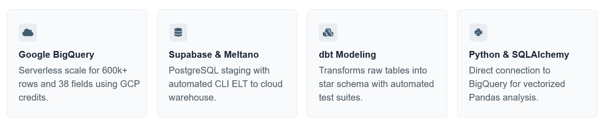   

This data pipeline architecture is chosen as firstly, we want all members to be able to access the data independently and directly so we decide to host in Google Big Query. Another reason mainly due to its records size of 600k and 38 fields and take advatage of the free GCP credit we have. 

We use SQL via duckdb to initially inspecting the data quality and found what look like errors. We then uses python (with the help of LLM) to get it clean before proceeding. 

To make the data analytics querying more efficient and to reduce redundancy, we want to apply ELT so that we can take advantage of the dbt transformation to apply star schema for efficent querying, transform data types, introduce new fields and do basic final data integrity test on the data sitting in the datawarehouse to ensure there are no issues further before starting with the analysis.

We then decide to use Meltano to facilitate ELT. We use Supabase to take advatage of the PostgreSQL database that we can tap via Meltano and target to Google Big Query. We then use dbt to transform the data and ensure then ensure the transformed data basic integrity check is done. 

We finally use SQLAlchemy in python to connect to the database and use fetch it into Pandas DataFrame to start with our exploratory data analysis and visualisation.


## Overview of Data pipeline

   Below is an overview of the data pipeline.


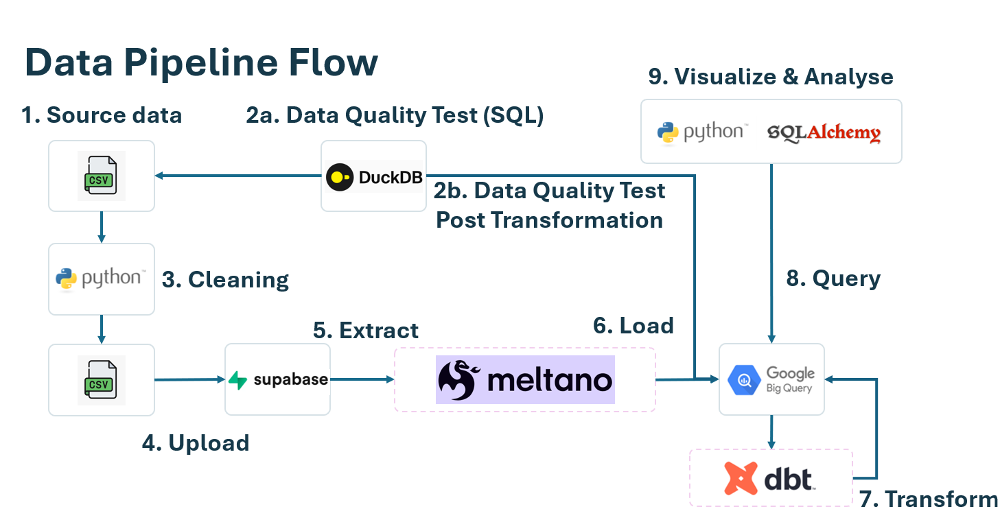   


1. **Source data from CSV**  
   Daily stock price data of S&P500 companies is sourced externally in csv file as 'sp500_panel.csv'. A brief description of the source files as follows:
   * Constituents and sectors: the current S&P 500 list (503 tickers from 500 companies) was scraped from Wikipedia’s “List of S&P 500 companies”, including GICS sector, sub-industry, date added and SEC company ID (CIK).

   * Prices: five years of daily open, high, low, close, adjusted close (for splits and dividends), volume, dividends and splits were downloaded from Yahoo Finance via the free yfinance Python package, in batches with an automatic retry.

   * Fundamentals: quarterly EPS, revenue, operating cash flow, capital expenditure, dividends per share, share counts and balance-sheet items came from the SEC’s free EDGAR XBRL “company facts” API. Year-to-date filings were converted into single quarters, Q4 was derived as the full year minus nine months, and figures were restated for stock splits to today’s share basis.

   * Merging: the two were joined into one daily panel (one row per ticker per trading day) using each quarter’s SEC filing date, so every day carries only data that was public at the time (no look-ahead bias). Valuation ratios (market cap, P/E, P/CF, P/B, dividend yield) were calculated from that day’s price.
      

2. **Data Quality Testing via SQL**  
   The original S&P 500 dataset (V1) was independently tested using custom SQL in DuckDB and BigQuery before cleaning. The quality checks covered source integrity, completeness, duplicate ticker-date records, OHLC and volume business rules, market-cap/share reconciliation, financial reasonableness, temporal consistency, snapshot/population consistency, referential integrity and post-ELT validation.
   
   The initial testing identified several material scaling anomalies, including Waters (WAT) with an approximately 1,000× share-count error and implausible market capitalisation, McDonald’s (MCD) with an abnormal share-count collapse, and extreme EPS movements in stocks such as Halliburton (HAL). An important finding was that two erroneous fields can still reconcile with each other; therefore, cross-field reconciliation alone was insufficient and was supplemented by reasonableness and temporal tests.

   These findings were used to improve the upstream Python data-cleaning process. The cleaned V2 dataset was subsequently reloaded into BigQuery and a targeted post-cleaning regression test was performed.

   V2 contained 622,710 stock-day records across 503 tickers, covering 8 October 2021 to 8 October 2026. The regression test confirmed that the previously identified WAT, MCD and HAL material anomalies had been corrected. It also found zero duplicate ticker-date records, zero orphan fact records, zero moving-average calculation mismatches and zero adjusted-close daily-return mismatches.
   The approach therefore preserved the original quality-test evidence while separately demonstrating that the identified material issues were remediated successfully in the cleaned warehouse dataset.


3. **Clean data via Python**  
   The source data is then clean using python with the help of LLM. The clean data is then output to csv for further processing. Checks added for data quality are as follows:
      
   * Units: some filings tag share counts in thousands or millions, or overstate EPS by a factor of 1,000 or more, so the pipeline now cross-checks shares × EPS against net income and uses the share price to decide which figure to correct. This fixed nine tickers, among them Waters, whose market cap had shown as $43 trillion, and McDonald’s.

   * Filtering: only quarterly and annual reports (10-Q, 10-K) are used, and each period must line up with a balance-sheet date. This drops stray pro-forma figures and acquired companies’ numbers.

   * Missing EPS: where a filer doesn’t tag EPS, it is calculated as net income ÷ diluted shares.

   * Verification: a final check flags blank or implausible market caps (below $1bn or above $8tn) and share-count jumps greater than 3× between quarters. Market caps for the 95 largest names were compared against an independent published ranking; 88 were within 5%.

   * Known limitations: Berkshire Hathaway, Visa and a few other companies with multiple share classes have no market cap, because the SEC data has no single share count for them. The constituent list is today’s, so the history has survivorship bias.


 
4. **Upload clean data to Supabase**  
   The clean csv data is then uploaded to Supabase (PostgreSQL) database so that we can further do ELT to Google BigQuery as final datawarehouse destination in hosting the data for further analytical query.


5. **Extract using Meltano**  
   Meltano is used to establish the extract and load pipeline to extract data from Supabase and load it into Google BigQuery for analytics purpose. At this step we start by initialising ```meltano```, giving it 'meltano-spelt' as its name and specify the extract step by using the tap-postgres to tap the data from Supabase. We use CLI to excute it using customised ```elt``` environment.
      > Code use: 
      ```
      meltano init meltano-spelt
      ```
      ```
      cd meltano-spelt
      ```
      ```
      meltano config set meltano python python3.11
      ```
      ```
      meltano add tap-postgres
      ```
      ```
      meltano config set tap-postgres --interactive
      ```
      We use config to set some configuration settings into ```meltano.yml```. The settings include, database, host, port and so on. Secrets are set in meltano ```.env``` file


6. **Load using Meltano**  
   After extract, Meltano is the used to continue load it into Google BigQuery to create the database table on cloud. At this step we add target-biquery to target the loading of data to Google BigQuery.
      > Code use: 
      ```bash
      meltano add target-bigquery
      ```
      ```bash
      meltano config set target-bigquery --interactive
      ```
      We use config to set some configuration settings into ```meltano.yml```. The settings include, batch size, credentials, dataset, project and so on.
      ```bash
      meltano run tap-postgres target-bigquery
      ```
      We then execute the ```meltano run``` to execute the extract and load. Prerequisite before loading we need to authenticate to GCP by running the below command:
      ```bash
      gcloud auth application-default login
      ```
      > Note- We did a reloading due to some data error found and use the below to rerun skipping the above configuration steps:
      ```bash
      meltano run tap-postgres target-bigquery --full-refresh
      ```


7. **Transform with dbt**  
   In the transformation, we applied a star schema with dimension table (dim_ticker) to place all the tickers information and fact tables (fact_dailyprice) to store the daily price and corresponding financial metrics. We use dbt to transform the loaded data into star schema by specifyig the SQL script(```fact_dailyprce.sql``` and ```star/dim_ticker.sql```) in the respective models and star folder. The transformation in the SQL script also contains new derived columns of moving averages of 20 days, 50 days, 100 days, 200 days and daily return. The database Google BigQuery database sources are specified in the ```sources.yml``` file.

   Before the data can be used for analystics, we also use dbt to implement data cleaning to convert certain fields to it's appropriate data type such as dates, integer and float as during load stage, often data are loaded as string type this are done in the SQL script. After that the data is transformed and loaded back into BigQuery for analysis-ready data table. Before it can be used, we implement data validation and quality testing steps using dbt default test, dbt utils and dbt Expectation in ```models/schema.yml``` and ```models/star/schema.yml``` to validate and test the transformed data to ensure no data integrity issue. Integrity that we test includes ensuring ids are unique, certain fields such as ticker and date is not null and is in date format, and expected string fields such as company name and sub-industry are string. 

   We need to specify below dbt packages prerequisite in ```pacakages.yml``` file.
   ```yml
   packages:
      - package: dbt-labs/dbt_utils
        version: 1.3.3
      - package: metaplane/dbt_expectations
        version: 0.10.10
   ```
   
   > Code use for dbt: 
      ```bash
      dbt init sp500
      ```

   We start first by initialising the dbt giving it 'sp500' as the name. We then are required to set the dbt profiles and settings such as: path to service account file, specifying GCP project id, naming the dataset and so on.
      ```bash
      dbt debug
      ```

   We then execute dbt debug to first ensure no debugging error.
      ```bash
      dbt deps
      ```

   We then execute dbt deps to install the relevant ```dbt_util``` and ```dbt-expectation``` packages. We also need to make sure we specify the packages
      ```bash
      dbt run
      ```

   We then execute dbt run to execute the creation of star schema tables, fields transformation and derived new columns.
      ```bash
      dbt test
      ```

   We then execute dbt test to excute the transformed data quality testing. We need to ensure there is no fail or error after the execution run is completed. Once there is no error, the data is ready to be used in Google. Below is what the final datawarehouse table look like in Google BigQuery:

   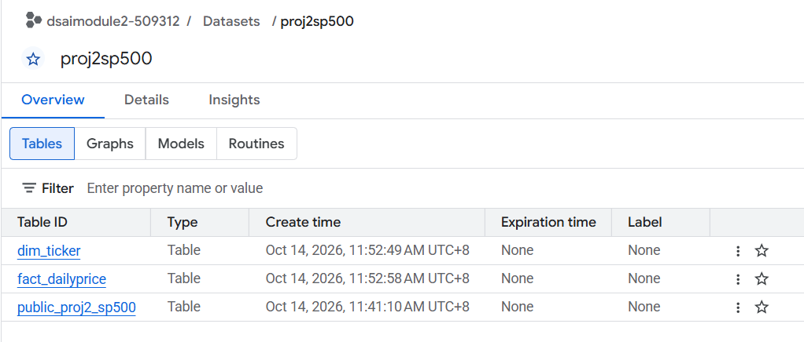   

      
8. **Query Google BigQuery with Python and SQLAlchemy**  
   We further use Python to connect to Google BigQuery using SQLAlchemy. In the extraction we join the fact table with dimension data to retrieves the data, and uses Pandas for analysis.
   > Some prerequisite installation includes as follow:
   ```Python
   !pip install sqlalchemy sqlalchemy-bigquery google-cloud-bigquery-storage pyarrow python-dotenv pandas
   ```

   We then run the following python script using sqlalchemy to connect to bigquery with the relevant settings secrets in the ```.env``` file.
   ```Python
   import os
   from dotenv import load_dotenv
   import pandas as pd
   from sqlalchemy import create_engine

   # Load environment variables from .env
   load_dotenv()

   project_id = os.getenv("GCP_PROJECT_ID")
   dataset_id = os.getenv("GCP_DATASET_ID")

   # SQLAlchemy BigQuery connection URI: bigquery://<project_id>/<dataset_id>
   engine = create_engine(f"bigquery://{project_id}/{dataset_id}")

   ```
   We then run the following script to query using SQLAlcehmy to test the data and load into Pandas Dataframe.
   ```Python
   # Simple query selecting recent prices and moving averages
   query = f"""
      SELECT 
         ticker,
         date,
         close,
         sma_20,
         sma_50,
         daily_return
      FROM `{project_id}.{dataset_id}.fact_dailyprice`
      WHERE ticker = 'NVDA'
      ORDER BY date DESC
      LIMIT 10
   """

   # Fetch into Pandas DataFrame
   df = pd.read_sql(query, con=engine)

   print("DataFrame Output:")
   print(df)
   print("\nDataFrame Info:")
   print(df.dtypes)
   ```
   We able to connect successfully with the follwing result:
   
   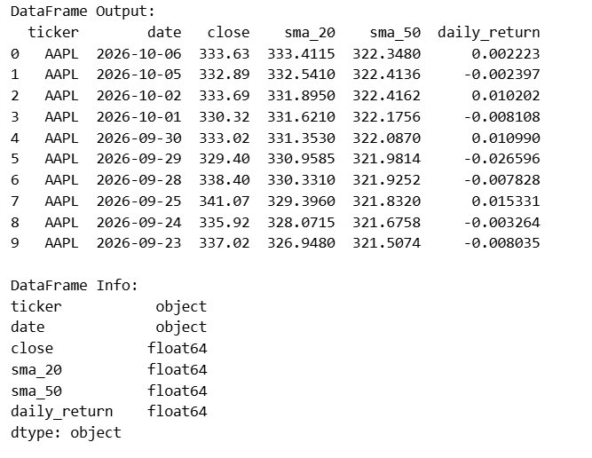

   We then start extracting the full fact_dailyprice data table joining with dim_ticker to get its ticker information and load into Pandas dataframe for further exploratory data analysis.
   ```Python
   # Simple query selecting recent prices and moving averages
   query = f"""
      SELECT 
         a.*,
         b.*
      FROM `{project_id}.{dataset_id}.fact_dailyprice` a
      left JOIN `{project_id}.{dataset_id}.dim_ticker` b ON a.ticker = b.ticker
      ORDER BY a.ticker, a.date
   """

   # Fetch into Pandas DataFrame
   df1 = pd.read_sql(query, con=engine)

   pd.set_option("display.max_columns", None)
   df1
   ```

9. **Visualize & Analyse with Pandas**  
   A simple analysis is done in Python via SQLAlchemy and output into Pandas dataframe. We then do simple exploratory data analysis and further massage data to visualise and analyse data based on some metrics to analyse tickers performance and trend.


## Visualisation & Analysis
Below are some analysis obtained.

### 1. Is there growth in Apple's annual returns for the last three 12-month trailing periods?

The first analysis done is to look at Annual Return Metric. We select one of the popular ticker AAPL (Apple Inc.) and analyse it's latest Year-On-Year stock performance by selecting from the latest ending of September performance and look back past 3 years. Below is the viusalisation on AAPL Year-On-Year returns using adjusted closing prices from October 2023 to end September 2026.

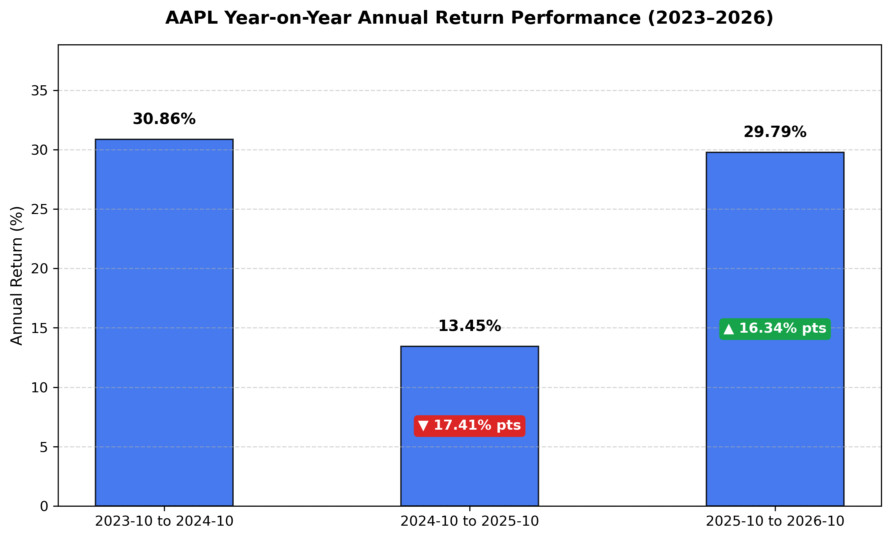

   **Observation**

   * Annual return Growth: Looking at the bar chart above starting with 2023-10 to 2024-09, we can see the annual return is at 30.86%. For the next period from 2024-10 to 2025-09 the annual return is only 13.45% showing a 17.41% percentage points decline from the previous period. In the following year however we can see the annual return has climb back up to 29.79% with 16.34% percentage points increase. 
   
   * Conclusion: This tells us that even though annual return has improved in for the latest past 12 months compared to previous year same period <b> but ultimately there is no incremental growth on annual return since 2 years ago (the period of 2023-10 to 2024-09).</b>

##


### 2. Average Daily return by Sector
   A simple exploratory analysis was performed using Python, pandas and SQLAlchemy on the transformed BigQuery warehouse.
   The analysis examines average daily return and daily return volatility by S&P 500 sector over the latest one-year period. Daily returns were selected instead of comparing absolute share prices because stock prices are not directly comparable across companies due to differences in share counts, stock splits and capital structures. Percentage returns provide a more consistent basis for cross-sector comparison.

   The analysis addresses two straightforward business questions:
   1. Which sectors generated the highest average daily returns during the latest year?
   2. Which sectors experienced the greatest daily return volatility?

   Data was retrieved by joining fact_dailyprice with dim_ticker. Sector-level statistics were then calculated in pandas using the mean and standard deviation of daily_return. The mean represents average daily performance, while the standard deviation provides a simple measure of daily price volatility.
   This analysis also makes use of the warehouse's derived daily_return field, which was independently reconciled during the data-quality testing process against adjusted-close returns with zero mismatches.

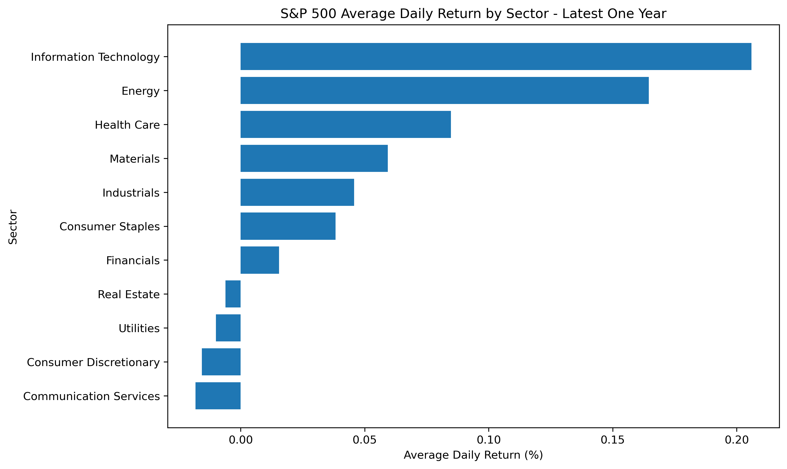


 **Observation**

   * Average Daily Return:
   Over the latest one-year period, Information Technology recorded the highest average daily return at 0.2060%, followed by Energy at 0.1645% and Health Care at 0.0847%. Seven of the eleven sectors produced positive average daily returns, while Real Estate, Utilities, Consumer Discretionary and Communication Services recorded slightly negative averages. Communication Services had the lowest average daily return at -0.0182%. Overall, the results indicate that Information Technology and Energy delivered the strongest average day-to-day stock performance during the period, although these results represent historical performance and should not be interpreted as forecasts of future returns.

   * Daily Return Volatility:
   Information Technology also recorded the highest daily return volatility at 3.6026%, followed by Health Care at 2.6306% and Communication Services at 2.5203%. At the other end, Utilities had the lowest volatility at 1.5530%, followed by Real Estate at 1.6357%. This suggests that Information Technology stocks experienced substantially larger day-to-day return fluctuations than the more stable Utilities and Real Estate sectors. Importantly, the sector with the strongest average return—Information Technology—also had the highest volatility, illustrating the basic risk-return trade-off: stronger historical returns in this period were accompanied by greater variability in daily performance.

   * Overall conclusion: The analysis shows that return and volatility should be considered together: Information Technology produced the strongest average daily return but also the greatest variability, while lower-volatility sectors such as Utilities provided more stable but weaker average performance.

##

### 3. NVDA (Nvidia): Sharpe ratio report


**Sector:** Information Technology · **Data to:** 08 October 2026 · **Risk-free rate:** 4.00% a year

| Window | Sharpe | Information Technology median | S&P 500 median | Annual return | Annual volatility | Total return | Percentile in S&P 500 |
|---|---|---|---|---|---|---|---|
| 1 year | **0.68** | 0.69 | 0.20 | 29.6% | 37.7% | 25.1% | 71 |
| 2 years | **0.79** | 0.66 | 0.25 | 38.7% | 43.8% | 78.1% | 80 |
| 3 years | **1.33** | 0.71 | 0.48 | 66.0% | 46.8% | 417.5% | 95 |
| 5 years | **1.12** | 0.49 | 0.27 | 62.2% | 51.9% | 1038.4% | 98 |

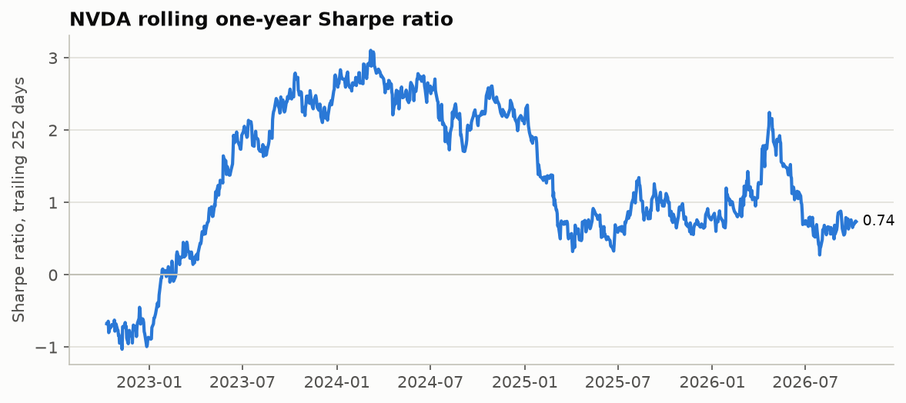
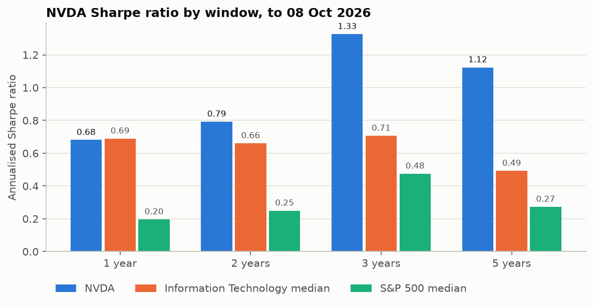
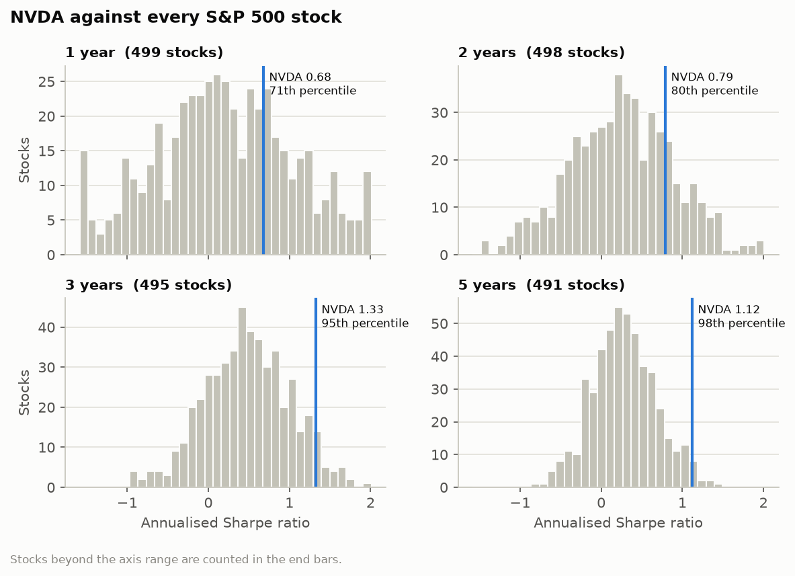

   
   ### Method
   - Daily return: change in `adj_close` (split- and dividend-adjusted) from the previous trading day.
   - Sharpe ratio: mean daily return minus the daily risk-free rate, divided by the standard deviation of daily returns,
   times sqrt(252).
   - An N-year window runs from the close N years before 08 October 2026 to that date. Stocks listed for less than
   the full window have no value for it.
   - Medians and ranks use today's S&P 500 members only, so they exclude companies that left the index.

   ### Observations
   * NVDA has an excellent Sharpe ratio > 1 over the past 3 to 5 years, given that it is an industry leader in Artificial Intelligence. 

   * A ratio above 1 means that it delivered an above market return for the amount of volatility associated with investing in the stock. Investing in stocks of companies under 1 leads to an inferior return compared to investing in a diversified basket of stocks like the S&P 500.

##

### 4. Sector Valuation

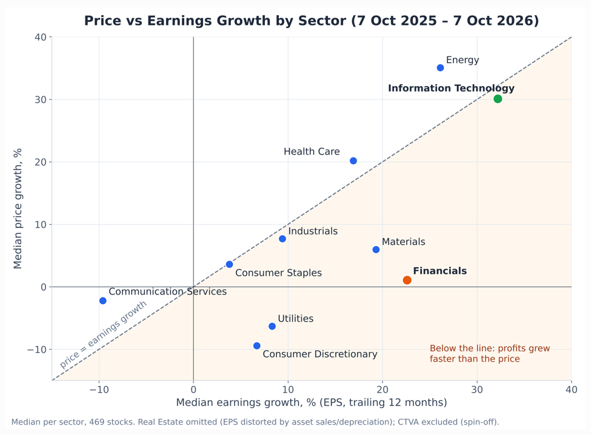

   ### Observation
   * Were sector price gains over the past year backed by profit growth? Using the team's `fact_dailyprice` and `dim_ticker` (read only), this compares each sector's median price growth with its median earnings growth from 7 Oct 2025 to 7 Oct 2026. 8 Oct is excluded as a partial-day download.

   * IT's rally was earned (price +30%, earnings +32%). Financials grew earnings 23% while its price rose only 1%, at the lowest P/E of any sector (14.3).

   * Conclusion: IT earned its rally; Financials grew profits 23% while prices stood still
##


### 5. Price momentum


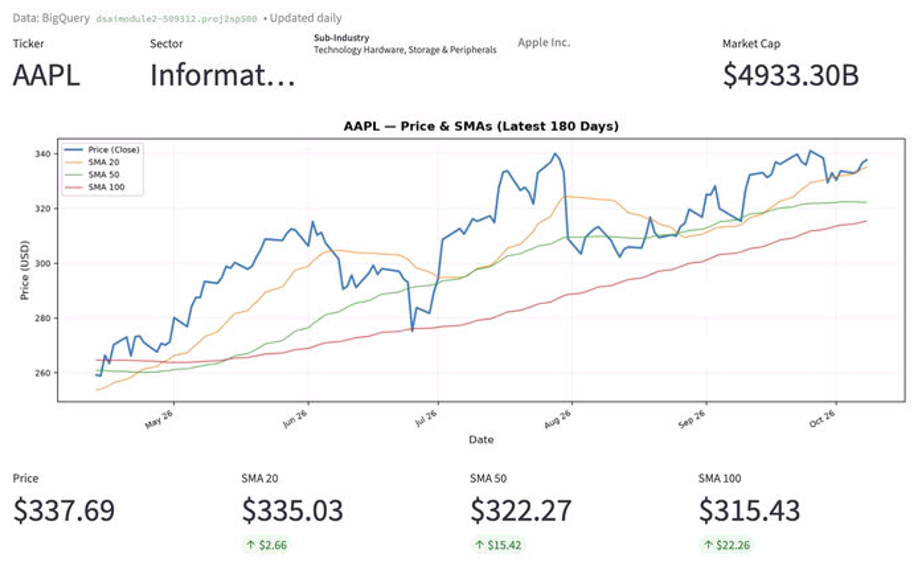
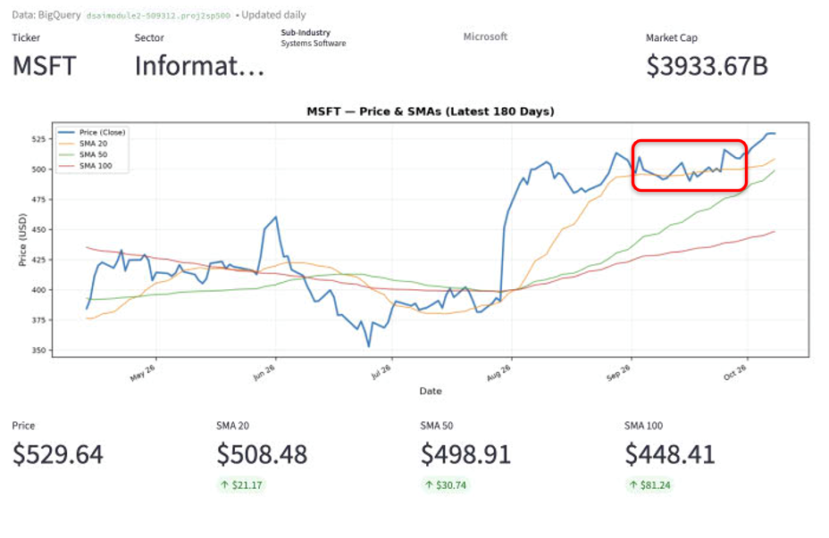
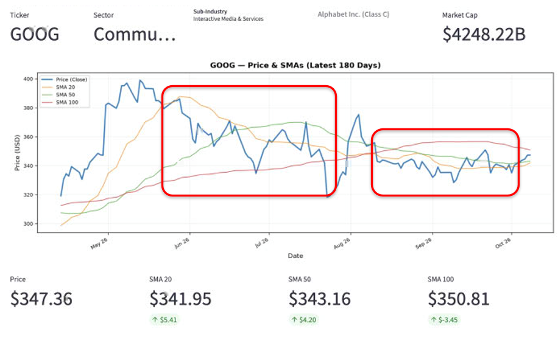
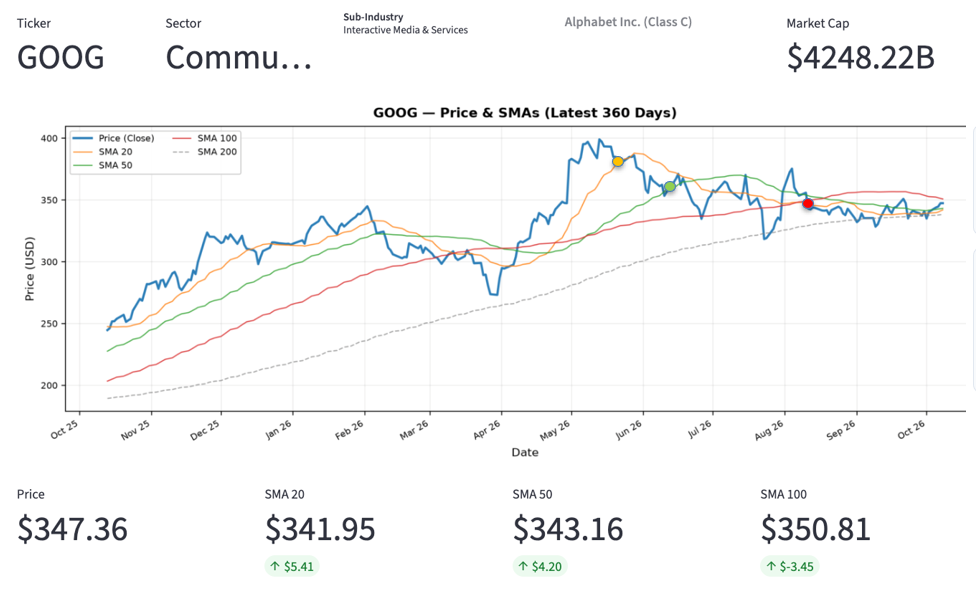
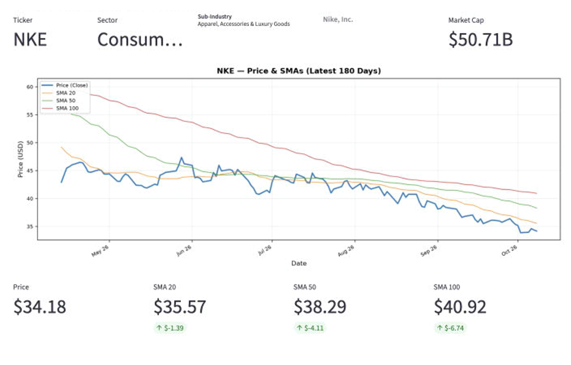


   ### Observations
   **Stock-level insights**
   * AAPL Return Growth: No incremental annual return growth since the 2023-2024 period.

   * NVDA Sharpe Ratio: Exceptional risk-adjusted Sharpe ratio > 1 over 3- and 5-year horizons.


   **Sector-level insights**
   * Risk-returns: Tech led in daily return (+0.21%) but exhibited greatest volatility (3.60%).

   * Price-profits: Tech earned its rally (+30% price +32% profits) vs. Financials grew profits without moving price (+1%, +23%)

   **Price momentum**
   * Price vs. Moving Average to show if stock is on uptrend, (short-term or deeper) pullback, or downtrend.
